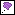
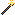
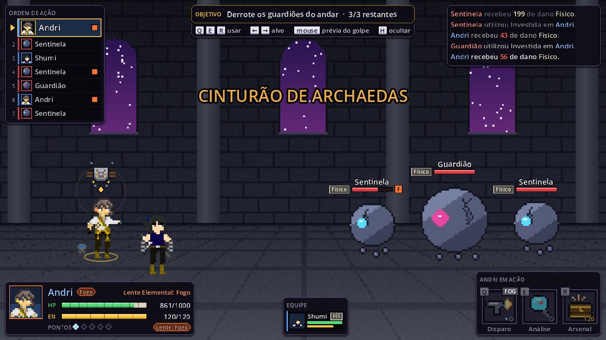

<p align="center"></p>

# 🗼 Tower of Realms

> Heróis de mundos diferentes sobem uma torre e enfrentam os guardiões de cada andar.

**Tower of Realms** é um RPG de combate por turnos em pixel art feito em **Godot 4.7**. A fila de turnos depende da velocidade de cada lutador, no estilo de *Honkai: Star Rail*, e a efetividade dos golpes depende do elemento, como em *Pokémon*. A equipe pode ter até três personagens, e cada um vem de um universo diferente e tem mecânicas próprias.


> ⚠️ **Protótipo.** Por enquanto existem quatro andares e dois personagens jogáveis. Os inimigos, o cenário e alguns efeitos usam arte provisória.

---

## Sumário

- [Como jogar](#-como-jogar)
- [Sistema de combate](#️-sistema-de-combate)
- [A Torre](#-a-torre)
- [Níveis e experiência](#-níveis-e-experiência)
- [Personagens](#-personagens)
  - [Shumi, espadachim do Kaioken](#-shumi--espadachim-do-kaioken)
  - [Andri Findavil, inventor e artífice](#-andri-findavil--inventor-e-artífice)
- [Inimigos](#-inimigos)
- [Rodando o projeto](#-rodando-o-projeto)
- [Estrutura do projeto](#-estrutura-do-projeto)
- [Adicionando um personagem](#-adicionando-um-personagem)
- [Documentação](#-documentação)

---

## 🎮 Como jogar

1. No **saguão**, ande com a Caoimhe até a porta da dungeon e aperte **Enter**.
2. Na **escolha do andar**, suba para um andar liberado. Os andares que você já venceu podem ser repetidos.
3. Na **seleção de equipe**, escolha os heróis. Cada andar tem um limite de personagens.
4. Na batalha, quando chega a vez de um aliado, escolha a ação:

| Tecla | Ação |
|---|---|
| **Q** | Ataque básico |
| **E** | Habilidade (skill) |
| **R** | Ultimate |
| **← / →** ou clique | Troca o alvo |
| **↑ / ↓** ou **1–9** | Escolhe uma opção nos seletores (elemento, artefato...) |
| **Enter** | Confirma |
| **Esc** | Cancela |

No fim do andar, vencendo ou perdendo, o resultado aparece e **Enter** (ou um clique) volta ao saguão. Para repetir um andar, é só subir de novo pela porta.

Passe o mouse sobre uma habilidade para ver quais alvos ela vai acertar antes de usar.

**Objetivo:** derrotar todos os guardiões do andar antes que a equipe caia.

---

## ⚔️ Sistema de combate

### Fila de turnos por velocidade
Cada lutador tem um *action value* (AV), que é quanto falta para ele agir. Quem tem o menor AV age primeiro. Depois de agir, ele volta para o fim da fila, a uma distância proporcional a `10000 / VEL`. Por isso, quem tem mais **VEL** age mais vezes. A ordem das próximas 7 ações aparece no canto da tela.

### Recursos
- **Pontos de skill** são compartilhados pela equipe. O time começa com 3 e o máximo é 5. O ataque básico **gera** 1 ponto, e a skill **gasta** 1. Revezar entre básicos e skills faz parte da estratégia.
- **Energia** é individual. Ela enche ao atacar e ao receber golpes e paga a ultimate.

### Dano
```
dano = ATQ × multiplicador × efetividade × 100 / (100 + DEF)   (±5% de variação)
```
O crítico multiplica o dano por **1,5×**. Escudos absorvem o dano antes do HP.

### Elementos
Cada lutador tem **um** tipo. Um golpe pode ser **super efetivo (2×)**, **pouco efetivo (0,5×)** ou neutro.

| Ataque | Super efetivo contra | Pouco efetivo contra |
|---|---|---|
| Físico | Arcano | Natureza |
| 🔥 Fogo | Gelo | Água |
| 💧 Água | Fogo | Eletricidade |
| ❄️ Gelo | Natureza | Fogo |
| ⚡ Eletricidade | Água | Natureza |
| 🌿 Natureza | Eletricidade | Fogo |
| ☠️ Veneno | Natureza | Ácido |
| 🧪 Ácido | Físico | Água |
| ☀️ Luz | Trevas | — |
| 🌑 Trevas | Luz | — |

**Arcano** tem regra própria: um alvo Arcano recebe 2× de *qualquer* tipo, e um ataque Arcano causa 2× em tudo, menos em Físico (0,5×).

### Estados
Buffs e debuffs (escudo, fraqueza, lentidão etc.) aparecem como ícones com a contagem de turnos acima de cada lutador.

---

## 🗼 A Torre

Cada ida à dungeon é um andar. Você vence e volta ao saguão. Vencer o andar N libera o N+1. Um andar repetido dá a XP de novo, mas os eventos de história só acontecem na primeira vitória.

| Andar | Equipe | Nível rec. | Limite de nível | Inimigos | XP |
|---|---|---|---|---|---|
| 1. Vigia da Entrada | 1 | 1 | 3 | 2 Sentinelas | 150 |
| 2. Salão do Guardião | 1 | 2 | 5 | Sentinela e Guardião (Golpe Pesado a cada 3). **O Andri chega** na primeira vitória | 350 |
| 3. Guarnição | 2 | 4 | 7 | Sentinela, Sentinela Veloz e Guardião de **Veneno** | 600 |
| 4. Trono Sombrio | 2 | 6 | 9 | Guardião Sombrio de **Trevas** (Golpe Pesado a cada 2) e Sentinelas de **Água** e de **Ácido** | 900 |

- **Nível recomendado:** é o nível de quem chega sem repetir nenhum andar.
- **Limite de nível:** é o do andar mais alto liberado. Ele deixa treinar até mais ou menos um nível acima do recomendado para o andar seguinte.
- **Tipos dos inimigos:** fazem parte do desafio. O Guardião de Veneno e o chefe de Trevas não são fracos a nenhuma lente do Andri, então pedem a Análise. A Sentinela de Água é super efetiva contra o Andri, e a de Ácido contra a Shumi.

Os andares ficam em `scripts/torre/andares.gd`. Para criar um andar novo, basta acrescentar um item na lista.

**Eventos de história** (`scripts/torre/eventos.gd`): o efeito vale na hora e fica salvo. A apresentação acontece no saguão, na volta. Por exemplo, o personagem surge com um anúncio, ou uma conversa se abre. Os eventos vêm do `ao_vencer` de um andar ou de uma fala de conversa (`"evento": "desbloquear:andri"`). Os tipos atuais:
- `desbloquear`: libera um personagem.
- `conversa`: abre uma conversa de `Conversas`. Ainda não há conversas escritas.

---

## 📈 Níveis e experiência

Cada personagem tem nível e XP próprios. As regras ficam em `scripts/personagens/progressao.gd`.

- **XP por vitória:** cada inimigo vale uma quantidade de XP, definida no andar.
  - **Quem lutou:** recebe a XP inteira, inclusive quem caiu.
  - **Reserva:** quem já foi liberado e ficou de fora recebe a mesma XP, para trocar de equipe não custar níveis.
  - **Bloqueados:** quem ainda não chegou à Torre não ganha nada.
  - **Derrota:** ninguém ganha XP.
- **Curva:** para ir do nível *n* ao *n+1* são necessários `100 + 50 × (n − 1)` de XP: 100, 150, 200, 250, 300… Do 1 ao 9 são 2.200 de XP.
- **Limite da Torre:** o limite de nível é o do andar mais alto liberado: 3, 5, 7 e 9. No limite, a XP fica em 0 e o excedente se perde, então liberar um andar não dá vários níveis de uma vez. Personagens acima do limite, por causa de um save antigo, não perdem nível. O nível máximo do jogo continua sendo 20.
- **Crescimento:** os atributos do kit valem para o nível 1. Cada nível soma o `crescimento` do personagem, definido em `Elenco.dados()`:

| Por nível | HP | ATQ | DEF | VEL |
|---|---|---|---|---|
| Shumi (ofensiva) | +60 | +8 | +2 | +0,5 |
| Andri (suporte) | +50 | +5,5 | +3 | +1 |

- **Personagem novo:** quem é desbloqueado entra na média de nível da equipe principal, arredondada e limitada ao limite da Torre, com 0 de XP e os atributos dele mesmo nesse nível. A equipe principal é a última montada na seleção. Se ainda não houver uma, conta a média de todos os personagens liberados.
- **Save:** o nível, a XP, a equipe e os andares vencidos ficam em `user://progresso.cfg`. O limite de nível é calculado a partir dos andares vencidos.

---

## 👥 Personagens

### 🔴 Shumi, espadachim do Kaioken
*Universo: Dragon Ball New Age* · Tipo: **Físico**

| HP | ATQ | DEF | VEL | Energia |
|---|---|---|---|---|
| 1200 | 150 | 50 | 105 | 120 |

A Shumi é uma personagem de **risco e recompensa**. O Kaioken aumenta o poder dela a cada nível, mas também consome o próprio corpo. Quanto mais ela sobe, mais forte fica o Engo-ji Beam e mais perto ela chega do limite.

 **Corte** · Básico (Q)
> Corte de katana em um alvo, com 1,0× ATQ. Gera **1 ponto de skill** e 20 de energia. A animação fica mais rápida e intensa conforme o nível do Kaioken.

 **Engo-ji Beam** · Skill (E) · custa 1 ponto
> Um feixe de energia que **muda conforme o Kaioken**:

| Nível | Nome | Alcance | Dano |
|---|---|---|---|
| Normal | Engo-ji Beam | Só o alvo | 1,8× |
| x2 | Engo-ji Beam Amplificado | Alvo + o inimigo logo atrás | 1,8× / 0,9× |
| x4 | Engo-ji Beam: Ruptura | Alvo + vizinhos | 1,8× / 0,9× |
| x10 | Engo-ji Beam: Devastação | Atravessa todos | 1,8× em todos |
| x20 | **Engo-ji Beam: Colapso** | Todos | **2,2×** em todos |

 **Kaioken** · Ultimate (R)
> Entra no Kaioken x2 (120 de energia) ou sobe um nível (80 de energia). Usar o Kaioken **não gasta o turno**. Cada nível dura 3 turnos dela, e subir de nível renova a duração.

| Nível | ATQ | VEL | Dreno de HP / turno | Energia do Limite Humano | Exaustão ao acabar |
|---|---|---|---|---|---|
| x2 | +20% | +20% | 3% | +15 | VEL −10% |
| x4 | +40% | +35% | 5% | +20 | VEL −20% |
| x10 | +80% | +55% | 8% | +25 | VEL −30% |
| x20 | +150% | +80% | 12% | +30 | VEL −40% **e perde o próximo turno** |

O dreno tira HP direto e ignora defesa e escudo. Quando o Kaioken acaba, ela fica **Exausta** por 2 turnos.

🛡️ **Limite Humano** · Passiva
> Se a Shumi sobrevive ao dreno do Kaioken no início do turno, ela recupera energia. Quanto mais alto o nível, mais energia ela ganha. Isso permite subir de nível em sequência... enquanto o HP aguentar.

**Dica:** suba até o x10 para limpar a tela com a Devastação. O x20 causa um dano enorme, mas a Shumi perde um turno quando ele acaba, e os inimigos aproveitam.

---

### 🟡 Andri Findavil, inventor e artífice
*Universo: Tales of Azeroth* · Tipo: **Fogo**

| HP | ATQ | DEF | VEL | Energia |
|---|---|---|---|---|
| 1000 | 130 | 45 | 112 | 120 |

O Andri é o **suporte tático** da equipe. Ele troca de elemento a cada turno, cria fraquezas nos inimigos e distribui artefatos titânicos para os aliados. Ele luta ao lado do **MOMC**, seu robô assistente.

 **Lente Elemental** · Passiva
> No início de cada turno do Andri, um **seletor radial** se abre em volta dele para escolher o elemento da lente (ou manter o atual). Esse elemento define o dano do Disparo, do MOMC e dos artefatos de dano.
> Elementos disponíveis: 🔥 Fogo · 💧 Água · ❄️ Gelo · ⚡ Eletricidade · 🌿 Natureza · ☠️ Veneno · 🧪 Ácido.

 **Disparo Elemental** · Básico (Q)
> Disparo de 0,8× ATQ com o elemento da lente. O **MOMC ataca junto** o mesmo alvo com um golpe separado de 0,35×. Gera **1 ponto de skill** e 20 de energia.

 **Análise de Vulnerabilidade** · Skill (E) · custa 1 ponto
> O inimigo fica **fraco** ao elemento de um aliado de pé, à escolha. Golpes desse elemento passam a ser super efetivos (2×) nele por 2 turnos. Não funciona em alvos Arcanos, que já recebem 2× de tudo.


 **Arsenal Titânico** · Ultimate (R) · 120 de energia
> Entrega **um artefato** a um aliado ou a si mesmo. Os efeitos duram 3 turnos do portador, exceto quando a descrição diz outra coisa.

| | Artefato | Efeito |
|---|---|---|
|  | **Olho de Odyn** | +50% de chance de crítico |
|  | **Mão de Tyr** | Escudo de 25% do HP máximo |
|  | **Sussurro de Loken** | Por 2 turnos, quem o portador acerta fica *Enganado* (ATQ −25% e a vez atrasa) |
|  | **Raiz de Freya** | Cura 30% do HP máximo e remove os efeitos negativos |
|  | **Manto de Hodir** | O próximo inimigo atingido fica *Lento* (VEL −30% por 2 turnos) |
|  | **Braço de Thorim** | Cada golpe causa +30% de dano extra do elemento da lente |
|  | **Cinturão de Archaedas** | HP máximo +30% |
|  | **Lança de Rá** | O próximo golpe causa +150% de dano extra do elemento da lente |



**Dica:** use a Análise com o elemento físico da Shumi e depois o Engo-ji em Devastação. Também funciona dar a Lança de Rá para ela antes de um Colapso.

---

## 👾 Inimigos

| Inimigo | Comportamento |
|---|---|
| **Sentinela** | Investida em um aliado aleatório |
| **Guardião** | A cada 3 ações solta um **Golpe Pesado** (1,8×). O ícone **!** avisa quando ele vai vir |
| **Guardião Ancestral** | Chefe de Gelo do andar 4, com Golpe Pesado a cada 2 ações |

Os status de cada um mudam por andar (ver `Andares.LISTA`). A arte ainda é provisória.

---

## 🚀 Rodando o projeto

**Requisitos:** [Godot 4.7](https://godotengine.org/download) (renderizador *Compatibility*).

```bash
git clone https://github.com/GuilhermeAndreotti/Tower-of-Realms.git
cd Tower-of-Realms
godot --path .          # abre o jogo (ou importe o project.godot no editor)
```

### Testes
Os testes rodam sem interface e usam um save só deles:
```bash
godot --headless --path . -s testes/teste_combate.gd     # regras de combate
godot --headless --path . -s testes/teste_progressao.gd  # níveis, XP, recompensas e save
godot --headless --path . -s testes/teste_lobby.gd       # saguão
godot --headless --path . -s testes/teste_torre.gd       # andares, história, escolha do andar
```

### Ferramentas
| Script | O que faz |
|---|---|
| `ferramentas/simular_andares.gd` | Simula os andares com a batalha de verdade e um piloto automático, e mostra as vitórias, os turnos e o HP restante em cada nível: `godot --headless --path . -s ferramentas/simular_andares.gd -- [rodadas] [andar:nível ...]` |
| `ferramentas/demo_captura.gd` | Joga uma batalha sozinho e salva capturas de tela: `godot --path . -s ferramentas/demo_captura.gd -- <pasta> shumi andri` |
| `ferramentas/gerar_andri.py` | Gera a spritesheet, o MOMC e os ícones do Andri a partir do sprite original (precisa do Pillow) |
| `ferramentas/gerar_assets_teste.py` | Gera a arte provisória (inimigos, cenário, onda do Engo-ji) |

---

## 📁 Estrutura do projeto

```
scenes/              cenas: saguão, escolha do andar, seleção de equipe e batalha
scripts/
  combate/           regras: combatente, fila de turnos, tipos, estados, inimigos, batalha
  personagens/       elenco + kit de cada herói (regras e animações separadas) + progressão
  torre/             andares e eventos de história
  lobby/             saguão, conversas e caixa de diálogo
  ui/                HUD, barras, slots de habilidade, seletor radial, efeitos visuais
personagens/         sprites, spritesheets e ícones de cada herói
inimigos/ cenarios/ efeitos/   arte dos inimigos, do cenário e dos efeitos
testes/              testes headless da lógica
docs/                documentação técnica
ferramentas/         scripts de captura e geração de assets
```

As **regras** (`Combatente`) ficam separadas das **animações** (`AcoesPersonagem`) e da **interface** (`HudBatalha`). Por isso a lógica pode ser testada sem abrir o jogo.

---

## ➕ Adicionando um personagem

O passo a passo está em [docs/jogo/personagens.md](docs/jogo/personagens.md). A batalha, a HUD e o sistema de níveis se adaptam sozinhos ao novo personagem.

---

## 📚 Documentação

A documentação técnica está em [`docs/`](docs/README.md): arquitetura, combate, progressão, Torre, saguão, testes e changelog. As mudanças de cada versão ficam no [CHANGELOG](CHANGELOG.md).
