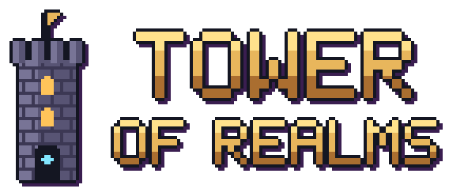
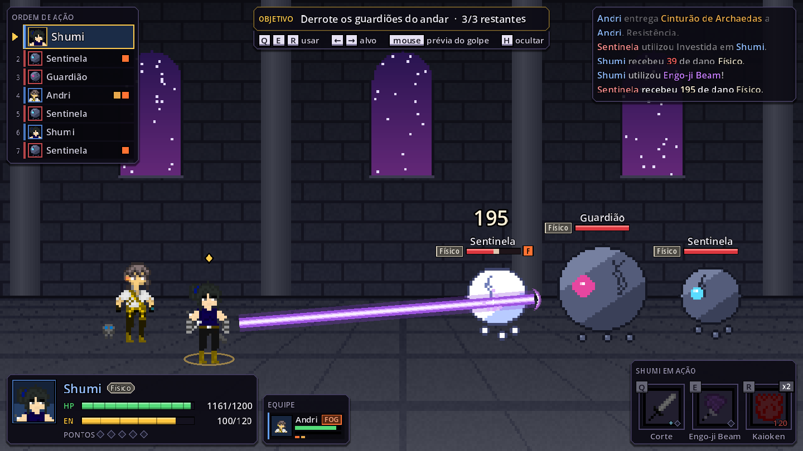

<p align="center"></p>

# Tower of Realms

> Heróis de mundos diferentes sobem uma torre e enfrentam os guardiões de cada andar.

**Tower of Realms** é um RPG de combate por turnos em pixel art feito em **Godot 4.7**. A fila de turnos depende da velocidade de cada lutador, no estilo de *Honkai: Star Rail*, e a efetividade dos golpes depende do elemento, como em *Pokémon*. A equipe pode ter até três personagens, e cada um vem de um universo diferente e tem mecânicas próprias.



> ⚠️ **Protótipo.** Por enquanto existem cinco andares e três personagens jogáveis. Os inimigos, o cenário e alguns efeitos usam arte provisória.

---

## Sumário

- [Como jogar](#-como-jogar)
- [Sistema de combate](#️-sistema-de-combate)
- [A Torre](#-a-torre)
- [Níveis e experiência](#-níveis-e-experiência)
- [Personagens](#-personagens): [Shumi](characters/shumi/README.md) · [Andri](characters/andri/README.md) · [Àskara](characters/askara/README.md) · [Clairin](characters/clairin/README.md) · [Lia Moonlight](characters/lia/README.md)
- [Inimigos](#-inimigos)
- [Rodando o projeto](#-rodando-o-projeto)
- [Estrutura do projeto](#-estrutura-do-projeto)
- [Adicionando um personagem](#-adicionando-um-personagem)
- [Documentação](#-documentação)

---

## 🎮 Como jogar

1. No **menu inicial**, escolha **NEW GAME** (jogo novo num dos 3 slots de save; um slot ocupado pede confirmação para ser sobrescrito; antes do saguão, a **introdução** conta a história da Caoimhe: **Enter** avança, **Esc** pula) ou **LOAD GAME** (continua um save). Nas duas listas, **Del** ou o botão **APAGAR** apaga um save, também com confirmação.
2. No **saguão**, ande com a Caoimhe até a porta da dungeon e aperte **Enter**.
3. No **mapa da Torre**, clique no círculo de uma missão para ver a ficha dela e clique de novo (ou **Enter**) para entrar. **↑/↓** trocam de andar e **←/→** trocam de missão no andar. As missões que você já venceu podem ser repetidas.
4. Na **seleção de equipe**, escolha os heróis. Cada missão tem um limite de personagens.
5. Na batalha, quando chega a vez de um aliado, escolha a ação:

| Tecla | Ação |
|---|---|
| **Q** | Ataque básico |
| **W** | Segunda habilidade (skill 2) |
| **E** | Habilidade (skill) |
| **R** | Ultimate |
| **← / →** ou clique | Troca o alvo |
| **↑ / ↓** ou **1–9** | Escolhe uma opção nos seletores (elemento, artefato...) |
| **Enter** | Confirma |
| **Esc** | Cancela |

No fim da missão, vencendo ou perdendo, o resultado aparece e **Enter** (ou um clique) volta ao saguão. Para repetir uma missão, é só subir de novo pela porta. No saguão, **Esc** volta ao menu inicial (o progresso já fica salvo a cada mudança).

Passe o mouse sobre uma habilidade para ver quais alvos ela vai acertar antes de usar.

**Objetivo:** derrotar todos os guardiões do andar antes que a equipe caia.

---

## ⚔️ Sistema de combate

### Fila de turnos por velocidade
Cada lutador tem um *action value* (AV), que é quanto falta para ele agir. Quem tem o menor AV age primeiro. Depois de agir, ele volta para o fim da fila, a uma distância proporcional a `10000 / VEL`. Por isso, quem tem mais **VEL** age mais vezes. A ordem das próximas 7 ações aparece no canto da tela.

### Recursos
- **Pontos de skill** são compartilhados pela equipe. O time começa com 3 e o máximo é 5. O ataque básico **gera** 1 ponto, e a skill **gasta** 1. Revezar entre básicos e skills faz parte da estratégia.
- **Energia** é individual. Ela enche ao atacar e ao receber golpes e paga a ultimate.
- **Fragmentos d'Alma** são só da Àskara, que não usa energia: pagam as invocações e o Lorde Demônio.
- **Chama Frenética** é só do Clairin: uma barra ao lado da energia que aumenta o dano dele e estoura nele se encher.

### Dano
```
dano = ATQ × multiplicador × efetividade × 100 / (100 + DEF)   (±5% de variação)
```
O crítico multiplica o dano por **1,5×**. Escudos absorvem o dano antes do HP.

### Elementos
Cada lutador tem **um** tipo. Um golpe pode ser **super efetivo (2×)**, **pouco efetivo (0,5×)** ou neutro.

| Ataque | Super efetivo contra | Pouco efetivo contra |
|---|---|---|
| Físico | Arcano | Natureza |
| 🔥 Fogo | Gelo | Água |
| 💧 Água | Fogo | Eletricidade |
| ❄️ Gelo | Natureza | Fogo |
| ⚡ Eletricidade | Água | Natureza |
| 🌿 Natureza | Eletricidade | Fogo |
| ☠️ Veneno | Natureza | Ácido |
| 🧪 Ácido | Físico | Água |
| ☀️ Luz | Trevas | — |
| 🌑 Trevas | Luz | — |

**Arcano** tem regra própria: um alvo Arcano recebe 2× de *qualquer* tipo, e um ataque Arcano causa 2× em tudo, menos em Físico (0,5×).

### Habilidades na barra
Cada personagem mostra na barra, sempre nesta ordem, o básico (Q), a skill (E), a skill 2 (W), a ultimate (R) e, por último, a **passiva**, marcada como PASSIVA e sem tecla. A skill 2 pode ser também uma passiva, como o Último Ato da Àskara, e fica no mesmo lugar. Nomes longos aparecem cortados e correm quando o mouse passa por cima. Passar o mouse sobre qualquer uma abre um cartão acima da barra com o custo, a recarga, o alvo e o elemento, um resumo, uma linha para cada item (demônio, artefato, nível do Kaioken) e, se ela não estiver pronta, o que falta. A montagem da equipe mostra os mesmos cartões.

As duas skills custam 1 ponto de skill cada. A do W tem também **recarga**: depois de usada, só volta alguns turnos depois (3 no Andri, 4 na Shumi), e a barra mostra no ícone quantos turnos faltam.

### Estados
Buffs e debuffs (escudo, fraqueza, lentidão etc.) aparecem como ícones com a contagem de turnos acima de cada lutador. Quem tem escudo ganha um **contorno azul na barra de HP**, com uma faixa azul do tamanho do escudo; no painel do personagem da vez, o valor do escudo aparece ao lado do HP (+N).

### Invocações
Algumas habilidades chamam criaturas para o lado da equipe. Elas têm vez própria na fila, HP e barra, e os inimigos podem atacá-las. Mas não fazem parte da equipe: agem sozinhas no inimigo marcado, não ganham XP, vão embora depois de algumas vezes e não seguram a luta (se a equipe cair, a luta acaba). O Andri pode entregar artefatos a elas. Ao ir embora por tempo ou ao cair, cada demônio da Àskara faz um **último ato**, e o Lorde Demônio explode em todos os inimigos.

---

## 🗼 A Torre

Cada ida à dungeon é uma missão. Você vence e volta ao saguão. Cada andar tem uma **missão principal**: vencer a do andar N libera o N+1 e abre as **missões secundárias** do andar N. As secundárias são opcionais. Elas trocam a repetição da mesma luta por lutas novas, feitas para o nível do andar seguinte. Uma missão repetida dá a XP de novo, mas os eventos de história só acontecem na primeira vitória.

O mapa não conta como uma luta funciona. Antes da primeira vitória, ele mostra só o nome, um texto de ambiente, o nível recomendado e o tamanho da equipe. Os inimigos e a XP aparecem depois, como lembrança do que você já enfrentou.

Missões principais (spoilers):

| Andar | Equipe | Nível rec. | Limite de nível | Inimigos | XP |
|---|---|---|---|---|---|
| 1. Vigia da Entrada | 1 | 1 | 3 | 2 Sentinelas | 150 |
| 2. Salão do Guardião | 1 | 2 | 5 | Sentinela e Guardião (Golpe Pesado a cada 3). Na história, **o Andri chega** na primeira vitória (por enquanto, todos já começam liberados) | 350 |
| 3. Guarnição | 2 | 4 | 7 | Sentinela, Sentinela Veloz e Guardião de **Veneno** | 600 |
| 4. Trono Sombrio | 2 | 6 | 9 | Guardião Sombrio de **Trevas** (Golpe Pesado a cada 2) e Sentinelas de **Água** e de **Ácido** | 900 |
| 5. Forja de Pedra | 3 | 8 | 11 | Golem de Pedra (chefe, Golpe Pesado a cada 3, volta como **Golem Incandescente**) e 2 Elementais de **Fogo** com o **Ferro Negro** | 1000 |

- **Nível recomendado:** é o nível de quem chega sem repetir nenhum andar.
- **Limite de nível:** é o do andar mais alto liberado. Ele deixa treinar até mais ou menos um nível acima do recomendado para o andar seguinte.
- **Tipos dos inimigos:** fazem parte do desafio. O Guardião de Veneno e o chefe de Trevas não são fracos a nenhuma lente do Andri, então pedem a Análise. A Sentinela de Água é super efetiva contra o Andri, e a de Ácido contra a Shumi.

Missões secundárias (spoilers):

| Andar | Missão | Equipe | Nível rec. | Inimigos | XP |
|---|---|---|---|---|---|
| 1 | Ronda da Escada | 1 | 2 | 3 Sentinelas | 180 |
| 2 | Ecos do Salão | 2 | 4 | 2 Guardiões, com os Golpes Pesados alternados | 400 |
| 3 | Corredor das Tochas | 2 | 6 | 3 Sentinelas Velozes | 450 |
| 3 | Cisterna | 2 | 6 | 2 Guardiões de **Veneno** | 500 |
| 4 | Capela Alagada | 2 | 8 | Guardião das Águas (**Água**) e 2 Sentinelas de **Ácido** | 650 |
| 4 | Vigília Sombria | 2 | 8 | 2 Guardiões Sombrios de **Trevas** (Golpe Pesado a cada 2) | 650 |
| 5 | Fornalha | 3 | 10 | 3 Elementais de **Fogo** com o **Ferro Negro** | 600 |
| 5 | Pedreira | 3 | 10 | 2 Golems de Pedra | 900 |

Os andares e as missões ficam em `tower/floors.gd`. Para criar um andar novo, basta acrescentar um item na lista; para criar uma missão secundária, um item no `"side"` do andar.

**Eventos de história** (`tower/story_events.gd`): o efeito vale na hora e fica salvo. A apresentação acontece no saguão, na volta. Por exemplo, o personagem surge com um anúncio, ou uma conversa se abre. Os eventos vêm do `on_win` de um andar ou de uma fala de conversa (`"event": "unlock:andri"`). Os tipos atuais:
- `unlock`: libera um personagem.
- `conversation`: abre uma conversa de `Conversations`. Ainda não há conversas escritas.

---

## 📈 Níveis e experiência

Cada personagem tem nível e XP próprios. As regras ficam em `progression/progression.gd`.

- **XP por vitória:** cada inimigo vale uma quantidade de XP, definida no andar.
  - **Quem lutou:** recebe a XP inteira, inclusive quem caiu.
  - **Reserva:** quem já foi liberado e ficou de fora recebe a mesma XP, para trocar de equipe não custar níveis.
  - **Bloqueados:** quem ainda não chegou à Torre não ganha nada.
  - **Derrota:** ninguém ganha XP.
- **Curva:** para ir do nível *n* ao *n+1* são necessários `100 + 50 × (n − 1)` de XP: 100, 150, 200, 250, 300… Do 1 ao 9 são 2.200 de XP.
- **Limite da Torre:** o limite de nível é o do andar mais alto liberado: 3, 5, 7, 9 e 11. No limite, a XP fica em 0 e o excedente se perde, então liberar um andar não dá vários níveis de uma vez. Personagens acima do limite, por causa de um save antigo, não perdem nível. O nível máximo do jogo continua sendo 20.
- **Crescimento:** os atributos do kit valem para o nível 1. Cada nível soma o `growth` do personagem, definido em `Roster.data()`:

| Por nível | HP | ATQ | DEF | VEL |
|---|---|---|---|---|
| Shumi (ofensiva) | +60 | +8 | +2 | +0,5 |
| Andri (suporte) | +50 | +5,5 | +3 | +1 |
| Àskara (invocadora) | +42 | +6 | +2 | +1 |
| Clairin (área) | +55 | +7,5 | +2,5 | +0,5 |
| Lia Moonlight (curandeira) | +55 | +5 | +3 | +0,5 |

- **Personagem novo:** quem é desbloqueado entra na média de nível da equipe principal, arredondada e limitada ao limite da Torre, com 0 de XP e os atributos dele mesmo nesse nível. A equipe principal é a última montada na seleção. Se ainda não houver uma, conta a média de todos os personagens liberados.
- **Save:** o nível, a XP, a equipe e os andares vencidos ficam no arquivo do slot (`user://progresso.cfg` no slot 1, `progresso_2.cfg` e `progresso_3.cfg` nos outros). O limite de nível é calculado a partir dos andares vencidos.

---

## 👥 Personagens

Cada personagem tem uma página própria com atributos e habilidades. Lá, o texto das habilidades é o mesmo do jogo (gerado a partir do kit), seguido de detalhes e dicas.

| | Personagem | Universo | Tipo | Papel |
|---|---|---|---|---|
| 🔴 | [**Shumi**, espadachim do Kaioken](characters/shumi/README.md) | Dragon Ball New Age | Físico | Risco e recompensa: o Kaioken aumenta o poder a cada nível, mas drena o HP dela. |
| 🟡 | [**Andri Findavil**, inventor e artífice](characters/andri/README.md) | Tales of Azeroth | Fogo | Suporte tático: troca de elemento, cria fraquezas e entrega artefatos, ao lado do robô MOMC. |
| 🟣 | [**Àskara**, invocadora do abismo](characters/askara/README.md) | Nariagari | Trevas | Invocadora: junta Fragmentos d'Alma e os gasta em demônios ou no Lorde Demônio. |
| 🟠 | [**Clairin**, portador da Chama Frenética](characters/clairin/README.md) | Tales of Azeroth | Fogo | Dano em área: a Chama Frenética fortalece tudo, mas estoura nele se a barra encher. |
| 🌙 | [**Lia Moonlight**, a Escolhida de Elune](characters/lia/README.md) | Tales of Azeroth | Luz | Curandeira: cura um aliado ou todos e, com o Lord Azeroth, corta 80% do próximo golpe de cada um. |

### Bônus de equipe

Fechar 3 personagens do mesmo universo dá um bônus a toda a equipe durante a luta. A montagem da equipe mostra quanto falta, e a luta começa anunciando o bônus.

| Bônus | Fecha com | Efeito |
|---|---|---|
| **Por Azeroth!** | 3 de Tales of Azeroth (Andri, Clairin e Lia) | +10% de dano e de cura para toda a equipe |

---

## 👾 Inimigos

| Inimigo | Comportamento |
|---|---|
| **Sentinela** | Investida em um aliado aleatório |
| **Guardião** | A cada 3 ações solta um **Golpe Pesado** (1,8×). O ícone **!** avisa quando ele vai vir |
| **Guardião Sombrio** | Chefe de Trevas do andar 4, com Golpe Pesado a cada 2 ações |
| **Golem de Pedra** | Chefe Físico do andar 5, lento e muito resistente, com Golpe Pesado a cada 3 ações. Derrotado, absorve os Elementais de pé e volta como **Golem Incandescente** |
| **Golem Incandescente** | De Fogo. Volta com 40% do HP máximo, mais 15% por Elemental absorvido. A cada 2 ações dispara o **Laser da Forja** em toda a equipe |
| **Elemental de Fogo** | Rápido e de Fogo (a lente Água do Andri dobra o dano nele) |

**Ferro Negro:** os Elementais de Fogo do andar 5, quando o HP cai abaixo de 30%, ativam o Ferro Negro uma vez por luta: "Ferro Negro ativado" aparece na tela e eles ganham um escudo de 25% do HP máximo por 3 turnos.

Os status de cada um mudam por andar (ver `Floors.LIST`). A arte ainda é provisória.

---

## 🚀 Rodando o projeto

**Requisitos:** [Godot 4.7](https://godotengine.org/download) (renderizador *Compatibility*).

```bash
git clone https://github.com/GuilhermeAndreotti/Tower-of-Realms.git
cd Tower-of-Realms
godot --path .          # abre o jogo (ou importe o project.godot no editor)
```

### Testes
Os testes rodam sem interface e usam um save só deles:
```bash
godot --headless --path . -s tests/test_combat.gd       # regras de combate
godot --headless --path . -s tests/test_progression.gd  # níveis, XP, recompensas e save
godot --headless --path . -s tests/test_lobby.gd        # saguão
godot --headless --path . -s tests/test_tower.gd        # andares, missões, história, mapa da Torre
godot --headless --path . -s tests/test_menu.gd         # introdução, menu inicial e slots de save
```

### Ferramentas
| Script | O que faz |
|---|---|
| `tools/simulate_floors.gd` | Simula os andares com a batalha de verdade e um piloto automático, e mostra as vitórias, os turnos e o HP restante em cada nível: `godot --headless --path . -s tools/simulate_floors.gd -- [rodadas] [andar[/missão]:nível ...] [team=askara,shumi] [side]` (`side` inclui as missões secundárias) |
| `tools/capture_demo.gd` | Joga uma batalha sozinho e salva capturas de tela: `godot --path . -s tools/capture_demo.gd -- <pasta> shumi andri` |
| `tools/generate_character_readmes.gd` | Atualiza os atributos e as habilidades no README de cada personagem, com o texto do jogo: `godot --headless --path . -s tools/generate_character_readmes.gd` |
| `tools/generate_andri.py` | Gera a spritesheet, o MOMC e os ícones do Andri a partir do sprite original (precisa do Pillow) |
| `tools/generate_askara.py` | Gera a spritesheet e os ícones da Àskara e reduz a arte das invocações para a arena (precisa do Pillow) |
| `tools/generate_clairin.py` | Gera as duas spritesheets do Clairin (normal e com a cabeça em chamas) e os ícones dele, a partir da folha original (precisa do Pillow) |
| `tools/generate_lia.py` | Gera a spritesheet da Lia (com a espada recortada e redesenhada para conjurar e para a estocada) e os ícones dela, a partir do sprite original (precisa do Pillow) |
| `tools/generate_tower_map.py` | Gera o fundo do mapa da Torre e os círculos de missão (precisa do Pillow) |
| `tools/generate_placeholder_art.py` | Gera a arte provisória (inimigos, inclusive o Golem nas duas formas, os cenários comum e da forja, onda do Engo-ji) e o ícone da passiva da Shumi |

---

## 📁 Estrutura do projeto

```
core/                o que não é de uma feature só (a máquina de estados)
combat/              batalha: cena, regras (combatente, estados, tipos, fila, invocações), base das animações e efeitos
  components/        componentes do lutador: HP, estados e recargas
  hud/               interface da batalha: HUD, slots de habilidade, ordem de ação, seletor radial
characters/          elenco e uma pasta por herói: regras, animações, sprites, ícones e README
enemies/             inimigo comum e a arte dos inimigos
progression/         níveis, XP e save
tower/               andares e missões, eventos de história, mapa da Torre e escolha da equipe
lobby/               saguão: cena, jogador, interagíveis, conversas, caixa de diálogo e arte
intro/               introdução do jogo novo
menu/                menu inicial e slots de save
ui/                  estilo e componentes de interface comuns (barra, cartão de habilidade)
tests/               testes headless da lógica
tools/               scripts de captura, simulação e geração de assets
docs/                documentação técnica
```

As **regras** (`Combatant`) ficam separadas das **animações** (`CharacterActions`) e da **interface** (`BattleHud`). Por isso a lógica pode ser testada sem abrir o jogo. O lutador é montado com componentes (HP, estados, recargas), a interface é avisada por sinais e as fases da batalha e do saguão são máquinas de estados ([padrões do projeto](docs/arquitetura/visao-geral.md#padrões)).

---

## ➕ Adicionando um personagem

O passo a passo está em [docs/jogo/personagens.md](docs/jogo/personagens.md). A batalha, a HUD e o sistema de níveis se adaptam sozinhos ao novo personagem.

---

## 📚 Documentação

A documentação técnica está em [`docs/`](docs/README.md): arquitetura, combate, progressão, Torre, saguão, testes e changelog. As mudanças de cada versão ficam no [CHANGELOG](CHANGELOG.md).
