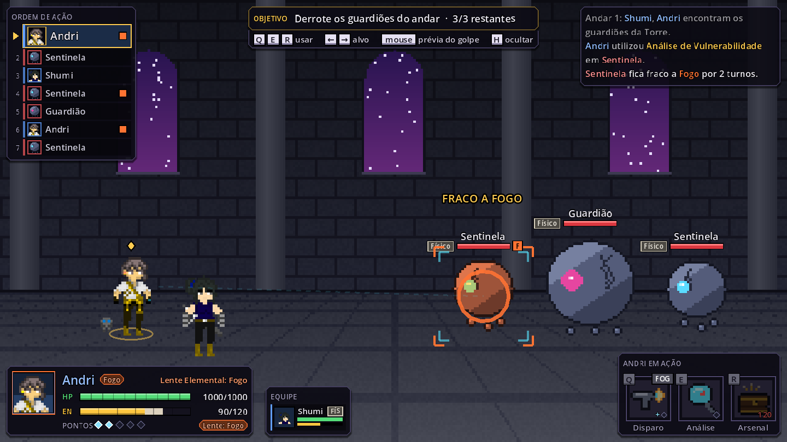
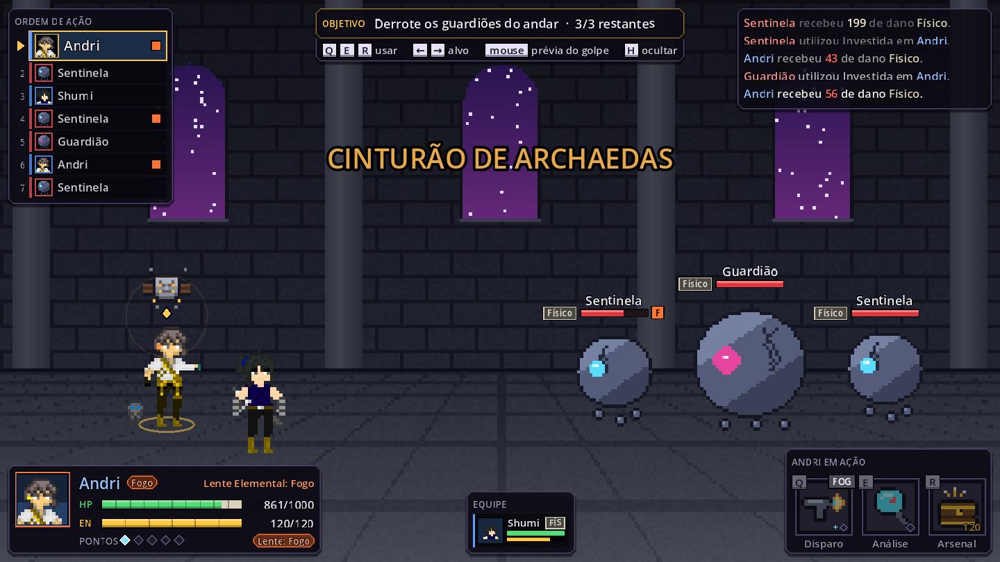

# 🟡 Andri Findavil, inventor e artífice

*Universo: Tales of Azeroth* · Tipo: **Fogo** · [← voltar ao README](../../README.md#-personagens)

O Andri é o **suporte tático** da equipe. Ele troca de elemento a cada turno, cria fraquezas nos inimigos e distribui artefatos titânicos para os aliados. Ele luta ao lado do **MOMC**, seu robô assistente.

<!-- gerado: tools/generate_character_readmes.gd -->
## Atributos

| | HP | ATQ | DEF | VEL | Energia |
|---|---|---|---|---|---|
| Nível 1 | 1000 | 130 | 45 | 112 | 120 |
| Por nível | +50 | +5,5 | +3 | +1 | — |

## Habilidades

> Texto igual ao do jogo, como aparece na montagem da equipe (nível 1, fora de qualquer forma).

###  Disparo
**Básico (Q)** · `gera 1 ponto` · `Alvo único` · `Fogo`

Disparo Elemental de Fogo no alvo; o MOMC ataca junto. Gera 1 ponto de skill.

###  Análise
**Skill (E)** · `1 ponto` · `Alvo único`

Análise de Vulnerabilidade: o alvo fica fraco ao elemento de alguém da equipe por 2 turnos.

###  Protocolo
**Skill 2 (W)** · `1 ponto` · `recarga 3 turnos` · `Alvo único`

Protocolo MOMC: o robô protege um aliado ou dispara forte num inimigo. Escolha ao usar:

- **Sobrecarga**: O MOMC dispara forte no inimigo (0,9x de Fogo).
- **Escudo**: O MOMC protege um aliado: escudo de 10% do HP máximo por 2 turnos.

###  Arsenal
**Ultimate (R)** · `120 energia` · `Aliado ou em si`

Arsenal Titânico: entrega um artefato a um aliado ou a si mesmo. Os efeitos duram 3 turnos do portador, salvo quando o artefato diz outra coisa.

- **Olho de Odyn** · *Precisão*: +50% de chance de crítico por 3 turnos.
- **Mão de Tyr** · *Proteção*: Escudo de 25% do HP máximo do alvo por 3 turnos.
- **Sussurro de Loken** · *Controle*: Por 2 turnos, quem o alvo acertar fica Enganado (ATQ -25% e a vez atrasa).
- **Raiz de Freya** · *Restauração*: Cura 30% do HP máximo e remove os efeitos negativos.
- **Manto de Hodir** · *Frio*: O próximo inimigo que o alvo acertar fica Lento (VEL -30% por 2 turnos).
- **Braço de Thorim** · *Poder elemental*: Cada golpe causa +30% de dano extra de Fogo por 3 turnos.
- **Cinturão de Archaedas** · *Resistência*: HP máximo +30% por 3 turnos.
- **Lança de Rá** · *Poder destrutivo*: O próximo golpe do alvo causa +150% de dano extra de Fogo.

###  Lente Elemental
**Passiva**

No início de cada turno, escolhe o elemento do Disparo, do MOMC e dos artefatos de dano.

<!-- fim do trecho gerado -->

## Mais detalhes

- **Lente Elemental:** no início de cada turno do Andri, um **seletor radial** se abre em volta dele para escolher o elemento da lente (ou manter o atual): 🔥 Fogo · 💧 Água · ❄️ Gelo · ⚡ Eletricidade · 🌿 Natureza · ☠️ Veneno · 🧪 Ácido. Os textos acima mostram a lente em Fogo.
- **Disparo:** o tiro é de 0,8× ATQ, e o MOMC ataca junto com um golpe separado de 0,35×. Gera 20 de energia.
- **Análise:** não funciona em alvos Arcanos, que já recebem 2× de tudo.
- **Protocolo:** o Escudo é bem menor que a Mão de Tyr, que é a ult. Gera 30 de energia.

**Dica:** use a Análise com o elemento físico da Shumi e depois o Engo-ji em Devastação. Também funciona dar a Lança de Rá para ela antes de um Colapso.
