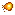
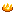
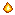

# 🟠 Clairin, portador da Chama Frenética

*Universo: Tales of Azeroth* · Tipo: **Fogo** · [← voltar ao README](../../README.md#-personagens)

O Clairin queima todos os inimigos de uma vez e paga com o próprio HP. A **Chama Frenética** sobe a cada ataque e deixa tudo mais forte, mas se encher, estoura nele. A decisão de cada turno é quanto deixar a barra subir antes de descarregar.

<!-- gerado: tools/generate_character_readmes.gd -->
## Atributos

| | HP | ATQ | DEF | VEL | Energia |
|---|---|---|---|---|---|
| Nível 1 | 1080 | 150 | 50 | 104 | 120 |
| Por nível | +55 | +7,5 | +2,5 | +0,5 | — |

## Habilidades

> Texto igual ao do jogo, como aparece na montagem da equipe (nível 1, fora de qualquer forma).

###  Bola de Fogo
**Básico (Q)** · `gera 1 ponto` · `Alvo único` · `Fogo`

Bola de fogo no alvo (como Lorde da Chama Frenética, em todos). Gera 1 ponto de skill e +20 de Frenesi.

###  Onda Frenética
**Skill (E)** · `1 ponto` · `Todos os inimigos` · `Fogo`

Uma onda de fogo atinge todos os inimigos (1,0x). Gera +30 de Frenesi.

###  Descarga
**Skill 2 (W)** · `1 ponto` · `recarga 3 turnos` · `Alvo + vizinhos` · `Fogo`

Gasta todo o Frenesi num golpe no alvo e nos vizinhos, sem estourar. Quanto mais cheia a barra, mais forte.

- **No alvo**: de 0,5x (barra vazia) a 2,0x (cheia); agora, 0,5x.
- **Nos vizinhos**: 60% do golpe no alvo.

###  Lorde da Chama Frenética
**Ultimate (R)** · `120 energia` · `não gasta o turno` · `Em si`

Ele vira o Lorde da Chama Frenética por 3 turnos dele, com a cabeça em chamas: a Bola de Fogo atinge todos e o estouro da barra queima também os inimigos. Entra com +30 de Frenesi.

- **Bola de Fogo**: Atinge todos os inimigos (1,0x).
- **Estouro**: Além de ferir o Clairin, queima todos os inimigos (2,0x).

###  Chama Frenética
**Passiva**

A barra sobe com os ataques dele e aumenta o ATQ, até +80% cheia. Se chega a 100, estoura: ele perde 20% do HP máximo (nunca cai por isso) e a barra zera.

- **Bola de Fogo** · *+20*
- **Onda Frenética** · *+30*
- **Lorde da Chama Frenética** · *+30*
- **Descarga** · *zera*

<!-- fim do trecho gerado -->

## Mais detalhes

- **Chama Frenética:** a barra fica ao lado da energia, no painel dele. Bola de Fogo dá +20 e Onda Frenética, +30; com a barra cheia, o ATQ dele sobe 80%. Ao chegar em 100, ela estoura: ele perde 20% do HP máximo (sem cair por isso) e a barra zera.
- **Descarga:** gasta a barra inteira num golpe no alvo e nos vizinhos, sem estourar. Vazia, é fraca (0,5x); cheia, chega a 2x.
- **Lorde da Chama Frenética:** não gasta o turno. Por 3 turnos dele, a Bola de Fogo atinge todos os inimigos e o estouro da barra queima também os inimigos.

**Dica:** encha a barra com a Onda Frenética e descarregue perto de 100. Como Lorde da Chama Frenética, deixar a barra estourar de propósito vira um ataque em área.
